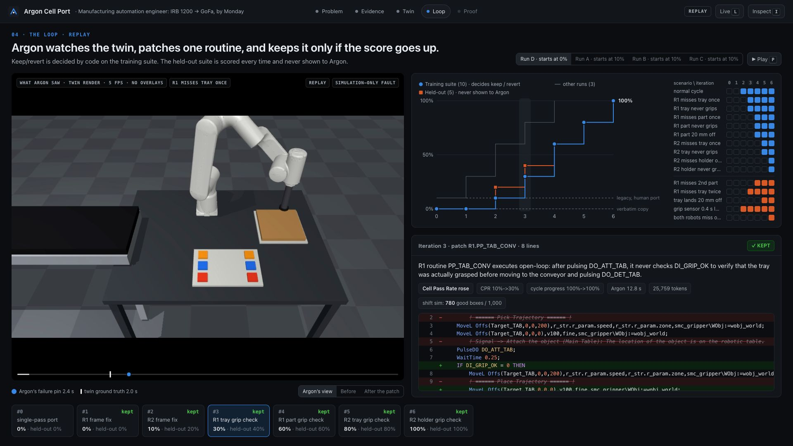
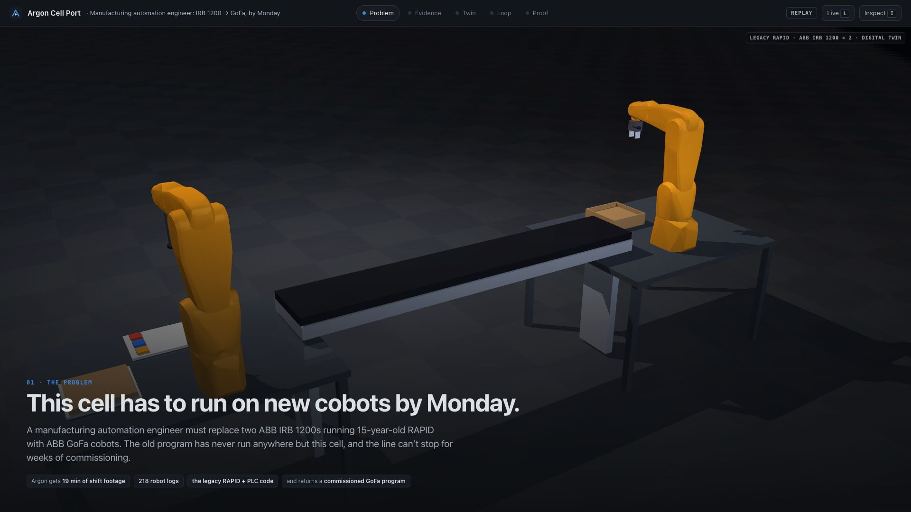
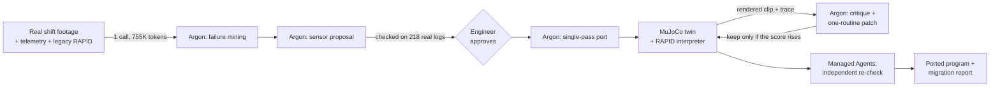
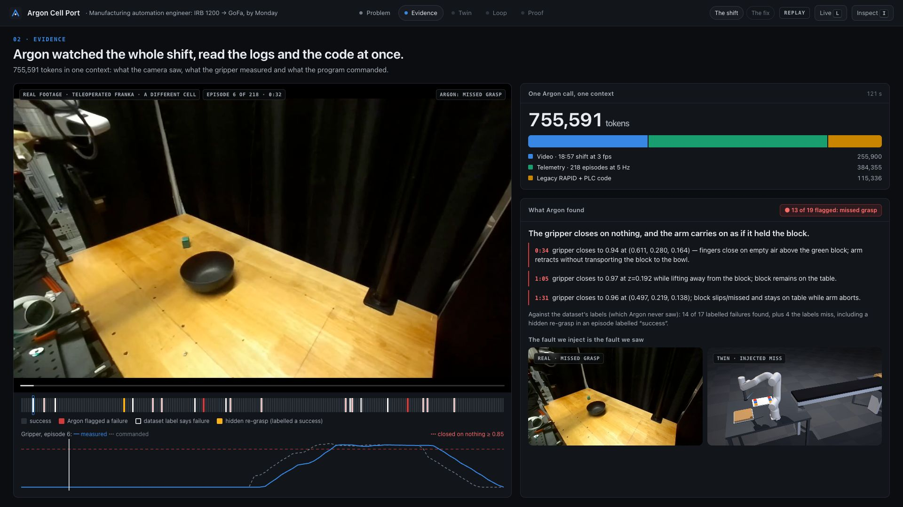
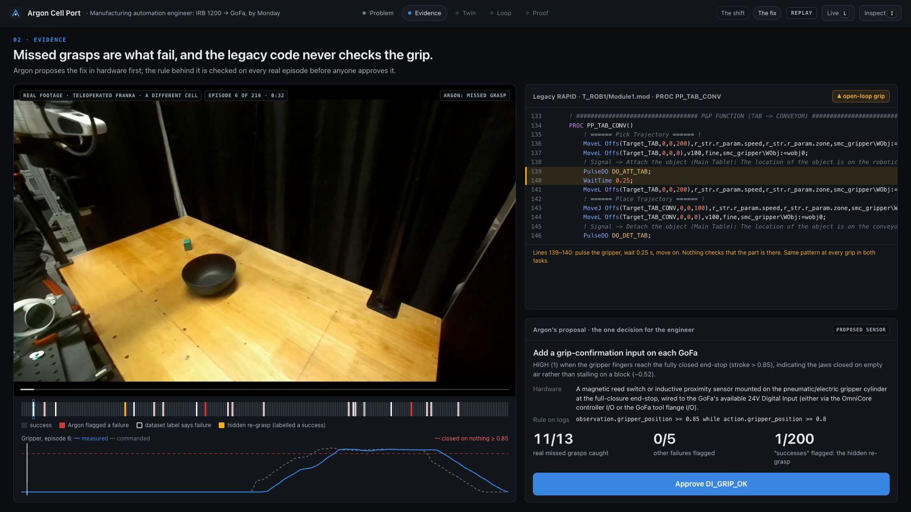
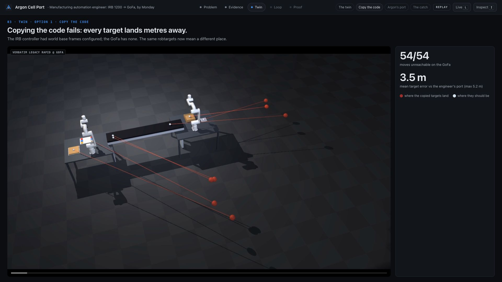
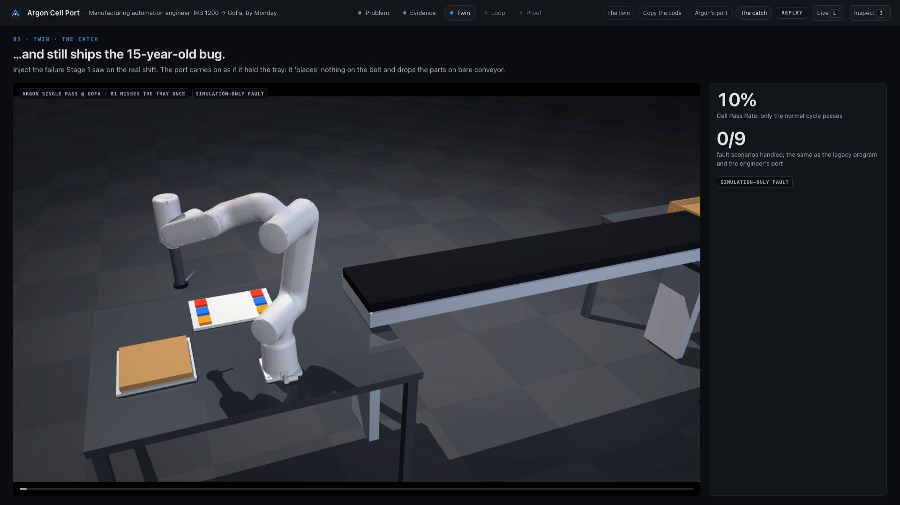
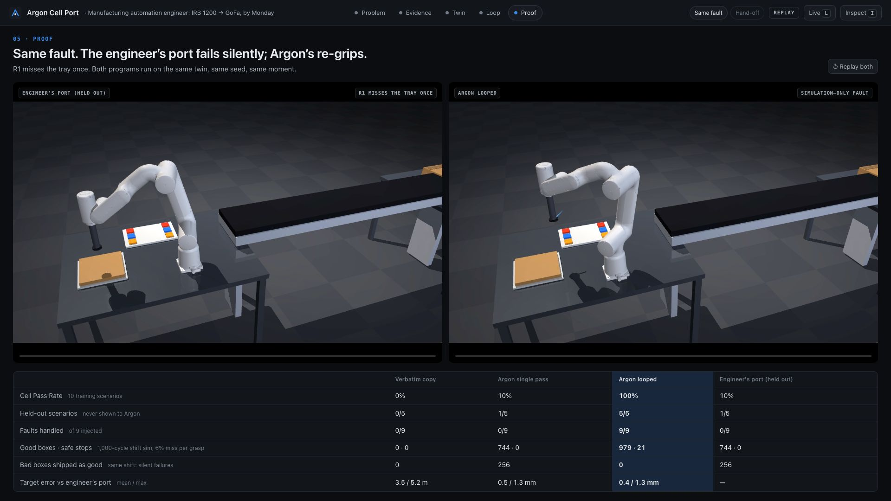
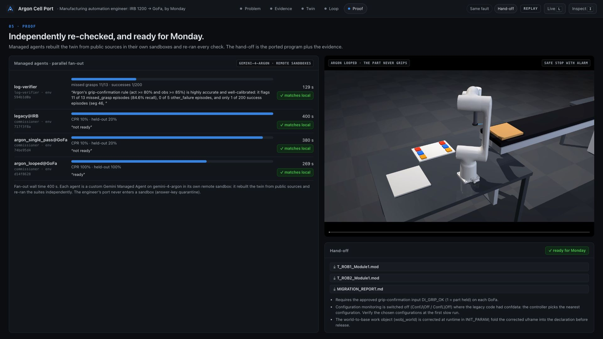

# Argon Cell Port

**Gemini 4 Argon ports a legacy ABB robot cell to new cobots, proves the port in a MuJoCo digital twin, and hardens
it against the failures it found in real robot footage.**

<p align="center">
  
</p>

<p align="center"><sub>The loop. Left: the twin clip Argon watched, with its failure pin. Right: the pass rate on the training
and held-out suites, and the RAPID patch Argon wrote. Bottom: one card per iteration.</sub></p>

| | |
|---|---|
| **10% → 100%** | Cell Pass Rate of Argon's port after 6 patches, chosen by the twin, not by hand |
| **5 / 5** | held-out fault scenarios passed; Argon never saw them, and they never decided a patch |
| **256 → 0** | bad boxes shipped as good per 1,000 simulated cycles, at the miss rate measured on real footage |
| **755,591 tokens** | in one Argon call: 19 minutes of video, 218 telemetry logs and the legacy code, read together |
| **4 / 4** | independent Gemini Managed Agents rebuilt the twin from public sources and reproduced every result |

---

## The problem

A manufacturing automation engineer has to replace two ABB IRB 1200 robots, running 15-year-old RAPID code, with
ABB GoFa cobots. The line can't stop for weeks of commissioning. The old program has never run anywhere except this
cell. Nobody fully knows which assumptions it makes about frames, configurations, timing or the grippers.

This is a common job. About **5 million** industrial robots are now working in factories ([IFR, 2026][ifr]).
Controller generations retire: ABB, for example, is moving IRC5 users to OmniCore and runs a dedicated
transition course ([ABB][abb-course], [ABB][abb-irc5]). Programming and integration are already a large share of a
cell's cost, roughly 15–45% by industry estimates ([LAN PDT][lanpdt], [Unchained Robotics][unchained]). Doing a
port by hand means re-teaching targets and hoping the old program's blind spots don't come along with it.



**Our data shows that they do.** The cell's original engineer also ported it to GoFa. That port is faithful: every
target is right and the normal cycle runs. It also keeps the legacy program's open-loop grip. When a grasp misses,
the robot carries on as if it held the part.

## What Argon does



### 1. Watch the shift

Argon reads the 19-minute shift video, the telemetry for all 218 episodes and the legacy RAPID and PLC code in
**one context**. It finds that missed grasps dominate: the gripper closes on nothing, and the arm carries on. It
links that to the legacy code's grip pattern: pulse the gripper, wait 0.25 s, move on. It found 14 of the 17
labelled failures, plus 4 the dataset's labels missed, including a re-grasp hidden inside an episode labelled
"success".



### 2. Propose the fix in hardware first

Before touching code, Argon proposes the one input that makes the silent failure detectable: a grip-confirmation
switch at the gripper's closed end-stop. It writes the rule as a threshold on the real telemetry. Code checks the
rule on every real episode before anyone approves it:

- **11 of 13** real missed grasps caught;
- **0 of 5** other failures flagged;
- **1 of 200** "successes" flagged, and that one is the hidden re-grasp.

The engineer clicks **Approve**. Only then does the loop learn that `DI_GRIP_OK` exists.



### 3. Port it, and test it in the twin

Copying the code verbatim fails outright. The IRB controller had world base frames configured and the GoFa has none,
so every target lands metres away (54/54 moves unreachable). Argon's single-pass port gets the geometry right, within
0.5 mm of the engineer's port, and the normal cycle runs. Then the twin injects the failure Stage 1 found, and the
port carries on without the tray. To see the code itself, the [appendix](#appendix-the-same-routine-three-ways)
puts one routine side by side: legacy, the engineer's port, and Argon's.

| Copying the code | Argon's single pass, with one missed grasp |
|---|---|
|  |  |

### 4. The loop: watch, patch one routine, keep it only if the score rises

Each iteration:
1. Run the 10-scenario suite.
2. Render the first failing scenario as a clean 8-second clip, with no overlay text.
3. Give Argon the clip, the trace, the current program and the Stage 1 findings.
4. Argon returns a timestamped observation, a root cause and **one** rewritten routine.
5. Code applies the patch, re-runs the suite, and keeps or reverts it.

In the primary run, Argon first fixed a frame error in its own port (one robot, then the other), then added a
grip check with one retry and a safe stop to each of the four grips. Each Argon call took 11–22 s, and the whole
run 146 s.

### 5. Prove it, and hand it off

The same fault on the same seed: the engineer's port fails silently, and Argon's re-grips. Four Gemini Managed
Agents then re-check everything independently in their own sandboxes. The hand-off is the two ported modules, plus
a migration report Argon writes from the measured results.





## Results

Every number is computed by code from recorded runs. The engineer's port is used only for scoring.

| | Verbatim copy | Argon single pass | **Argon looped** | Engineer's port (held out) |
|---|---|---|---|---|
| Cell Pass Rate (10 training scenarios) | 0% | 10% | **100%** | 10% |
| Held-out scenarios (never shown to Argon) | 0/5 | 1/5 | **5/5** | 1/5 |
| Fault scenarios handled | 0/9 | 0/9 | **9/9** | 0/9 |
| Good boxes / 1,000 cycles (6% miss per grasp) | 0 | 744 | **979** | 744 |
| Bad boxes shipped as good | 0* | 256 | **0** | 256 |
| Safe stops with alarm | 0 | 0 | 21 | 0 |
| Target error vs engineer's port (mean / max) | 3.5 m / 5.2 m | 0.5 / 1.3 mm | 0.4 / 1.3 mm | – |

<sub>*The verbatim copy ships nothing: all 1,000 cycles end in a controller fault.</sub>

**Repeatability.** Four loop runs from two different single-pass ports all reach 100% on both suites:

| Run | Starting port | Training suite by iteration | Held-out suite by iteration | Wall time |
|---|---|---|---|---|
| D (primary) | 0%: frame sign error | 0 → 0 → 10 → 30 → 60 → 80 → 100% | 0 → 0 → 20 → 40 → 60 → 80 → 100% | 146 s |
| A | 10% | 10 → 30 → 60 → 80 → 100% | 20 → 40 → 60 → 80 → 100% | 102 s |
| B | 10% | 10 → 30 → 60 → 80 → 100% | 20 → 40 → 60 → 80 → 100% | 113 s |
| C | 10% | 10 → 30 → 60 → 80 → 100% | 20 → 40 → 60 → 80 → 100% | 121 s |

**Is the critique really visual?** In an ablation, Argon got only an 8-second clip: no overlay text, no trace and no
program. It classified 8/8 clips correctly (4 missed grasps and 4 good grasps). Across every loop iteration, its
failure timestamps land within 0.07–0.4 s of the twin's ground truth.

## Questions

<details>
<summary><b>1. What is the legacy code, how is it translated, and does Argon watch it run?</b></summary>

<br>

**The legacy code** is real ABB RAPID from an open-source RobotStudio station
([R. Parak, MIT][rparak]). One IRC5 controller (RobotWare 6) drives two IRB 1200s:

- **Robot 1** (`T_ROB1/Module1.mod`, 283 lines) moves a tray from its table to the conveyor, then sorts two coloured
  parts onto it.
- **Robot 2** (`T_ROB2/Module1.mod`, 156 lines) boxes the tray and places the box holder.

Targets are `robtarget`s in world coordinates; they only work because the controller's `MOC.cfg` has base frames
configured. Every grip is open-loop: `PulseDO …; WaitTime 0.25;` and move on. The same author ported the cell to two
GoFa CRB 15000s on OmniCore; that port is our held-out answer key.

**Translation** is Argon. One call (about 1 minute, `thinking_level=medium`) reads the legacy modules and the cell
facts (mounting points, frames, tools, I/O) and writes both GoFa programs. The loop then improves that program one
routine at a time.

**What Argon watches.** There are two kinds of video, and neither is the legacy code running on real hardware,
because no such footage exists publicly.
- **Stage 1** watches *real* footage: a teleoperated Franka in a different lab (the DROID dataset), used to learn how
  grasps actually fail.
- **The loop** watches the *twin* running Argon's ported program on the GoFa.

The legacy program does run in the twin, on the IRB 1200. That run defines where every part must end up (the
oracle), and running it with an injected fault shows the silent failure.
</details>

<details>
<summary><b>2. How does this map to the real job of porting an old robot to a new cobot?</b></summary>

<br>

The engineer's job has three parts, and the demo does each one:

1. **Translate the program to the new robot.** The frames, configurations and controller differences are what break
   a verbatim copy (54/54 targets unreachable).
2. **Prove it works before the line goes down.** That's virtual commissioning: the twin runs both robots, the
   conveyor and the grippers, and checks every part against the legacy program's own outcome.
3. **Don't carry known weaknesses into the new cell.** The failure mode comes from real footage, the fix starts as a
   hardware decision the engineer approves, and the program is hardened against it.

The output is what the engineer would hand over on Monday: two `.mod` files, the one wiring change, and a migration
report with the risky changes called out and a cutover checklist.
</details>

<details>
<summary><b>3. How are Gemini Managed Agents used?</b></summary>

<br>

As independent verifiers, so the process that optimized the program never grades itself. In one parallel fan-out
(400 s wall time), four custom Managed Agents ran, each on `gemini-4-argon` (base agent
`antigravity-preview-09-2026`) in its own remote sandbox:

- **`log-verifier`** gets Argon's proposed grip rule and the 218 real telemetry logs. It writes its own analysis
  script and returns the confusion matrix: 11/13, 0/5, 1/200.
- **Three `commissioner`s**, one each for legacy on the IRB, Argon's single pass and Argon looped. Each one:
  - clones this repository at a pinned commit;
  - rebuilds the robot models from the public ROS descriptions;
  - runs both suites and a 200-cycle Monte Carlo;
  - renders a proof clip;
  - writes a "ready / not ready" note.

All four results match the local runs exactly. The engineer's port never enters a sandbox. The inner loop calls Argon
directly instead, because each iteration needs an answer in 11–22 s. Code: [`loop/agents.py`](loop/agents.py).
</details>

<details>
<summary><b>4. What metric is being climbed, what is the loop doing, and how do we know there's no cheating?</b></summary>

<br>

**The metric** is the Cell Pass Rate: the share of 10 training scenarios passed.
- **Scenarios:** 1 normal cycle and 9 faults. Each of the 4 grips gets a miss once and a miss every time, plus one
  part displaced by 20 mm.
- **"Miss once"** must still deliver every part to within 10 mm of where the legacy program puts it, with zero
  violations.
- **"Miss every time"** must end in a safe stop with an alarm, never carrying on as if the part were held.

**Keep or revert is decided by code.** A patch is kept if:
- the pass rate goes up; or
- it ties, and the normal cycle gets further; or
- both tie, and there are fewer violations.

In every case, the normal cycle may not slow down by more than 10%.

**What the loop does:** suite → render the first failing scenario → Argon (clip + trace + program + Stage 1) → one
routine → syntax check (at most 40 changed lines) → suite → keep or revert.

**Contamination controls:**
- **The quarantine is in code.** [`loop/argon_client.py`](loop/argon_client.py) is the only path to Argon. It
  rejects any payload from the answer-key paths, and any payload containing a numeric literal from the engineer's
  port's targets. It logs a manifest of every call: each part's source, sha256 and tokens by modality.
- **Only the scorer reads the answer key.** [`loop/score.py`](loop/score.py) is never imported by the loop.
- **A held-out suite.** 5 scenarios Argon never sees, never used to decide a patch:
  - a second-part miss;
  - two misses in a row;
  - a tray landing 20 mm off-centre;
  - a grip sensor 0.4 s late, which must not false-alarm;
  - both robots missing once.
- **Repeats and independent re-checks.** 4 loop runs from 2 different starting ports, 3 single-pass trials, and 4
  Managed Agent re-checks from public sources.

**Honest limits.**
- The held-out faults are new combinations of the same families (misses, displacement, sensor timing), not new
  physics.
- We designed the twin and the suite. The pass rules are in [`simulation/scenarios.py`](simulation/scenarios.py) for
  anyone to audit.
</details>

<details>
<summary><b>5. What does this do that only Argon can do?</b></summary>

<br>

- **One context across modalities.**
  - What's in it: 18:57 of video (255,900 tokens), telemetry for all 218 episodes (384,355) and the legacy RAPID and
    PLC code (115,336: this cell's programs plus related legacy codebases), in a single call.
  - What it produced: findings that tie a visual event ("fingers close on empty air above the green block") to a
    measured reading ("gripper closes to 0.94") and to the code pattern that ignores it.
  - Why one context matters: the sensor threshold comes from that joint reading. Chunking would separate the frame
    from the log line.
- **Video understanding of its own simulations.** It works from pixels alone (8/8), and it's fast enough (11–22 s)
  to sit inside a keep-or-revert loop.
- **Long, exact generation.** It writes two full controller programs in one pass, and a cross-referenced migration
  report.
- **Agents on Argon.** The independent verifiers are Argon agents in their own sandboxes.
</details>

<details>
<summary><b>6. Where is Argon used, and is "video plus code in one context" real?</b></summary>

<br>

| Step | Done by |
|---|---|
| Failure mining on the 19-min shift (video alone: 263K tokens; unified: 755,591) | **Argon** |
| Grip-sensor proposal and its telemetry rule | **Argon**; checked by code and by a Managed Agent |
| Single-pass port of both programs | **Argon** |
| Every loop critique and patch | **Argon** |
| Independent re-commissioning | **Argon** Managed Agents (4) |
| Migration report | **Argon** |
| Twin, RAPID interpreter, scorer, dashboard | deterministic code written for this project, so the judge is never the model being judged |

**Yes, it's real.** The 755,591-token request has three kinds of part in one call:
- the shift video at 3 fps;
- the telemetry as text;
- the code as text.

The token counts by modality come from the API's own usage metadata. Every loop call likewise sends a video part
together with the program text. Each call's manifest (sources, hashes, tokens, latency) is in the dashboard's
inspector.

**One caveat.** The footage and the ABB code come from different cells. The joint reasoning connects a failure
*mode* seen on a real robot to the code *pattern* that can't detect it. It doesn't show the same physical robot.
</details>

<details>
<summary><b>7. How would this work in the real world?</b></summary>

<br>

**Inputs:**
- the cell's controller backup: RAPID modules plus the `SYSPAR` configs, such as `MOC.cfg` for frames and `EIO.cfg`
  for I/O;
- the station layout or CAD;
- the new robot's model;
- line footage and controller logs from the running cell or from sister cells.

**Evaluated:**
- **Behaviour.** Does the ported program put every part where the legacy program does? The legacy program run in
  the twin is the reference.
- **Resilience.** Does it survive the failures that actually happen on the line?

**Improved:** the program, routine by routine, plus the one or two hardware inputs it needs to detect failures.

**Output:** ported modules, a migration report with risky changes flagged, and a cutover checklist. The first
physical run happens at reduced speed. The report already flags the two changes a human must verify:
- configuration monitoring turned off (`ConfJ\Off`);
- a work object corrected at runtime.

**Why it matters now.** The installed base is large and ageing ([IFR][ifr]), controller platforms turn over
([ABB][abb-irc5]), and integration labour is a big share of every cell's cost ([LAN PDT][lanpdt]). Today, a port is
judged done when the normal cycle runs. That's the bar the engineer's port met, and it still ships 256 bad boxes per
1,000 cycles at a realistic miss rate. Getting past that bar means reading hours of footage, logs and code together,
and watching your own simulations critically. That's the part only a model like Argon makes practical.
</details>

<details>
<summary><b>8. How is MuJoCo used? Did Argon make the 3D models?</b></summary>

<br>

**No, Argon did not make the 3D models.**
- **Robots.** The IRB 1200-5/0.9 and GoFa CRB 15000-5/0.95 are converted from public ROS descriptions
  ([PickNik `abb_ros2`][abb-ros2], [`abb_gofa_robot`][gofa], Apache-2.0) by
  [`tools/build_robot_mjcf.py`](tools/build_robot_mjcf.py). Their reach is checked against the datasheets (0.901 /
  0.950 m).
- **The cell.** Tables, conveyor, trays and parts are generated by code from the station's CAD bounding boxes and
  the legacy target positions. It's a faithful layout but simplified geometry.

**MuJoCo 3.17** (Python bindings) is used for:
- forward kinematics;
- Jacobians for damped-least-squares IK;
- ABB configuration (`confdata`) computation;
- straight-line `MoveL` tracking, with a singularity check;
- scene assembly with `MjSpec`;
- offscreen rendering: 960×544 at 5 fps for Argon, 1080p "cinema" clips with markers for people.

The simulation is **kinematic**: grasps are attach and detach events driven by the interpreter's I/O, and faults
are failed attaches. Robot-to-cell collisions aren't checked.

**Where it runs:** locally, and inside the Managed Agents' remote sandboxes. Each agent pip-installs MuJoCo,
rebuilds the models from the ROS sources, and renders with OSMesa (no GPU). The Antigravity CLI can't select
`gemini-4-argon`, so every Argon call goes through the Gemini API.
</details>

## Run it

```bash
python3.12 -m venv .venv && source .venv/bin/activate && pip install -r requirements.txt
echo "GEMINI_API_KEY=..." > .env.local                    # only needed for Live mode and the loop
(cd dashboard && npm install && npm run build)
python tools/build_demo.py --loop runs/loop_final_d \
    --repeats runs/loop_final_a,runs/loop_final_b,runs/loop_final_c \
    --single runs/single_pass_20261025_152644           # -> demo_bundle/
python dashboard/server.py                              # http://127.0.0.1:8787
```

| Key | Action |
|---|---|
| `→` `←` | next / previous beat (Problem, Evidence, Twin, Loop, Proof) |
| `P` | play the current beat |
| `L` | **Live**: run the real loop from a cached port (~2 min), or the full pipeline from Stage 1 (~6 min, with the sensor approval as the human step) |
| `I` | inspector: every Argon call's inputs, tokens and latency |

Replay mode needs no API key and starts instantly. Live mode falls back to Replay, with a label, if a call fails.

Run the loop on its own: `python loop/run_loop.py --iters 8`. The checkpoint-by-checkpoint build log is in
[`progress/README.md`](progress/README.md).

## Repository

```
loop/         Argon client (quarantine + call manifests), Stage 1, sensor proposal, port loop, managed agents, report
simulation/   RAPID parser and interpreter, two-robot cell logic, scenario suites, kinematics, renderer
tools/        robot model converter, demo bundle builder, Monte Carlo, commissioning, progress gallery
dashboard/    Vite + React dashboard and the server for Replay and Live
models/       MuJoCo models of the IRB 1200 and GoFa CRB 15000
derived/      measured facts the pipeline produces (oracle, Stage 1 findings, sensor proposal)
tests/        model reach, kinematic acid test, cell suite, pixel-only critic ablation
progress/     build log and every screenshot in this README
```

## Limitations

- **The footage is from a different robot.** DROID's teleoperated Franka supplies the failure modes and their real
  rate (6% per grasp). It is not footage of this cell.
- **Faults and the grip sensor are simulated.** `DI_GRIP_OK` is a proposed input, approved in the demo; it isn't
  installed hardware.
- **The cell is simplified.** Geometry is placeholder-grade, collisions with the cell aren't checked, motion zones run
  as fine points, and cycle times are approximate.
- **Two changes in the port need a human check** before release (both are in the migration report):
  - configuration monitoring is switched off (`ConfJ\Off`/`ConfL\Off`), so the controller picks the nearest
    configuration;
  - a work-object correction is applied at runtime rather than in its declaration.

## Data and credits

- **Legacy and engineer-ported RAPID, station data:**
  [rparak/ABB-RobotStudio-SortingProductionLine][rparak] (MIT).
- **Real footage and telemetry:** DROID ([Khazatsky et al., 2024][droid]), via the LeRobot ports `jnogga/droid_success`
  and `jnogga/droid_failure` (CC BY 4.0). One lab scene, 218 episodes.
- **Robot descriptions:** [PickNikRobotics/abb_ros2][abb-ros2] and [byeongkyu/abb_gofa_robot][gofa] (Apache-2.0).
- **Built with:** Gemini 4 Argon (`gemini-4-argon`), Gemini Managed Agents, MuJoCo 3.17, `google-genai`.

## Appendix: the same routine, three ways

This shows how the port works, using one real routine: Robot 1 picks the tray off its table and puts it on the
conveyor (`PROC PP_TAB_CONV`). Only the pick half is shown, because the place half follows the same pattern. `...`
marks arguments cut for width, and `!` starts a comment.

### 1. Legacy program (ABB IRB 1200)

```
CONST robtarget Target_TAB:=[[-3469.53,-3150.92,37.5],[0,-0.7071,0.7071,0],[0,0,0,0],...];

PROC PP_TAB_CONV()
    MoveL Offs(Target_TAB,0,0,200), ..., smc_gripper\WObj:=wobj0;       ! move above the tray
    MoveL Offs(Target_TAB,0,0,0), v100, fine, smc_gripper\WObj:=wobj0;  ! move down onto it
    PulseDO DO_ATT_TAB;                                                 ! fire the gripper
    WaitTime 0.25;                                                      ! wait a quarter second
    MoveL Offs(Target_TAB,0,0,200), ..., smc_gripper\WObj:=wobj0;       ! lift and carry on
```

- **Positions** are in factory-floor coordinates. That only works because the old controller was configured with where
  each robot stands on the floor.
- **The grip** fires, waits a quarter second and moves on. Nothing checks that the tray was picked up.

### 2. The human engineer's port (ABB GoFa, held out, used only for scoring)

```
CONST robtarget Target_TAB:=[[149.017,611.162,36],[0,1,0,0],[0,0,-2,0],...];

PROC PP_TAB_CONV()
    MoveJ Offs(Target_TAB,0,0,200), ..., smc_gripper;
    MoveL Offs(Target_TAB,0,0,0), v100, fine, smc_gripper;
    PulseDO DO_ATT_TAB;
    WaitTime 0.25;
    MoveL Offs(Target_TAB,0,0,200), ..., smc_gripper;
```

- **Positions:** every one is re-measured in the new robot's own coordinates, which is why the numbers are completely
  different. The arm-posture settings are adjusted too, and the first move becomes a joint move (`MoveJ`).
- **The grip is unchanged:** fire, wait, move on. When a grasp misses, this robot also carries on and "places" a tray
  it isn't holding.

### 3. Argon's port after the loop (ABB GoFa)

```
! converts the old factory-floor coordinates into this robot's coordinates
TASK PERS wobjdata wobj_world:=[FALSE,TRUE,"",[[-3356.18,2943.42,0],[0.7071,0,0,-0.7071]],...];
CONST robtarget Target_TAB:=[[-3469.53,-3150.92,37.5],[0,-0.7071,0.7071,0],[0,0,0,0],...];

PROC PP_TAB_CONV()
    MoveL Offs(Target_TAB,0,0,200), ..., smc_gripper\WObj:=wobj_world;
    MoveL Offs(Target_TAB,0,0,0), v100, fine, smc_gripper\WObj:=wobj_world;
    PulseDO DO_ATT_TAB;
    WaitTime 0.25;
    IF DI_GRIP_OK = 0 THEN                          ! did we actually get it?
        MoveL Offs(Target_TAB,0,0,200), ..., smc_gripper\WObj:=wobj_world;     ! back off
        MoveL Offs(Target_TAB,0,0,0), v100, fine, smc_gripper\WObj:=wobj_world; ! come back down
        PulseDO DO_ATT_TAB;                         ! try once more
        WaitTime 0.25;
        IF DI_GRIP_OK = 0 THEN                      ! still nothing?
            ErrWrite "R1 tray grasp failed", "DI_GRIP_OK=0 after retry";      ! raise an alarm
            Stop;                                   ! stop safely instead of carrying on
        ENDIF
    ENDIF
    MoveL Offs(Target_TAB,0,0,200), ..., smc_gripper\WObj:=wobj_world;
```

- **Positions:** Argon keeps the original numbers and adds one conversion (`wobj_world`) that tells the new robot
  where the factory floor is relative to itself. Targets land within 0.4 mm of the engineer's port on average (1.3 mm at most).
- **The grip** is checked with the sensor Argon proposed and the engineer approved. On a miss, the robot backs off and
  tries once more. If that fails too, it raises an alarm and stops instead of shipping an empty box. The loop added
  the same check at the other three grip points, one patch at a time.

**Flagged in the migration report for a human to check:**
- The conversion values declared at the top have the wrong sign. The loop's first patch corrects them when the
  program starts (in `INIT_PARAM`), and the report asks for that correction to be moved into the declaration.
- Argon switches off the arm-posture checks (`ConfJ \Off`) instead of setting new postures, as the engineer did. The
  postures the controller picks should be verified on the first slow run.

[ifr]: https://ifr.org/ifr-press-releases/five-million-robots-now-operate-in-factories-globally
[abb-course]: https://app1.edoobox.com/en/ABBGB/OmniCore%20Controller%20Industrial%20robots/OmniCore%20Controller%20Industrial%20Robots/Course.ed.100f553f1c85_13045289173.Transition%20from%20IRC5%20to%20OmniCore
[abb-irc5]: https://new.abb.com/products/robotics/de/campaigns/tschuess-irc5
[lanpdt]: https://lanpdt.com/tech-talk-episode-19/
[unchained]: https://blog.unchainedrobotics.de/en/how-much-does-a-turnkey-robotics-solution-cost
[rparak]: https://github.com/rparak/ABB-RobotStudio-SortingProductionLine
[droid]: https://droid-dataset.github.io/
[abb-ros2]: https://github.com/PickNikRobotics/abb_ros2
[gofa]: https://github.com/byeongkyu/abb_gofa_robot
