# Progress gallery

What the twin is being evaluated on, checkpoint by checkpoint. Every image is rendered from a real run by
`tools/make_progress.py` (re-run it to refresh). The cell geometry is a **placeholder** built from the legacy
targets and the CAD bounding boxes; in Loop 1, Argon authors the real scene.

| Checkpoint | Gate | Status |
|---|---|---|
| M0: live API checks | Argon text/video/critique, Managed Agents on Argon, sandbox renders MuJoCo | ✅ |
| CP1: robot models | IRB 1200-5/0.9 and GoFa CRB 15000-5/0.95 reach match the datasheets (0.901 / 0.950 m) | ✅ |
| CP2: kinematic acid test | Legacy@IRB and human port@GoFa reach every target; verbatim copy@GoFa fails | ✅ |
| CP3: interpreter + cell + scenario suite | Full two-robot cycle runs; missed grasp → silent failure; suite solvable to 100% | ✅ |
| CP4: Argon port loop | single-pass port → critique of rendered failure → one patch → keep/revert; Cell Pass Rate climbs | ✅ 10% → 100% in 4 iterations |
| CP5: prove the loop is *visual* | video-only critic (no overlay text, no trace) still diagnoses the failure | ✅ 8/8 |

## M0: what Argon can do (measured live, 2026-10-25)

| Check | Result |
|---|---|
| Blind critique of 4 sim renders with injected faults | **4/4 correct**, 3.8–7.2 s each (`thinking_level=low`, 5 fps) |
| Failure mining on the full 19-min shift (3 fps) | recall 17/18, precision 89%, 82 s, 263k tokens |
| One prompt with video + telemetry + code | 755,591 tokens, 121 s |
| Custom Managed Agent on `gemini-4-argon` | accepted; 3 parallel sandboxes patch and render in ~2 min |

## CP1: robot models (converted from the ROS descriptions)

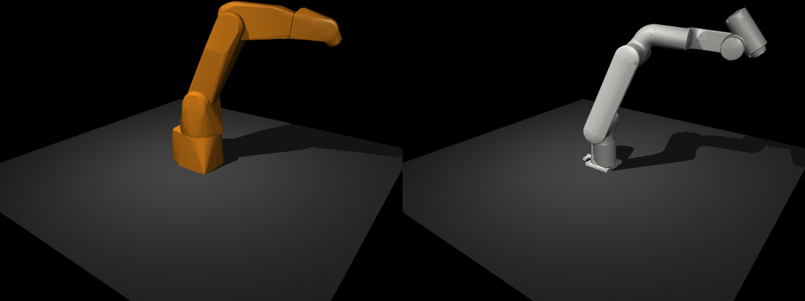

IRB 1200-5/0.9 (left) and GoFa CRB 15000-5/0.95 (right), converted from the ROS xacro descriptions to MuJoCo
by `tools/build_robot_mjcf.py`.

## CP2: kinematic acid test (Robot 1 cycle, 54 moves per program)

| Program @ robot | Unreachable | Config violations | MoveL failures |
|---|---|---|---|
| legacy @ IRB 1200 | 0 | 0 | 0 |
| legacy, verbatim @ GoFa | **54/54** | – | – |
| Argon single-pass @ GoFa | 0 | 0 | 0 |
| human port @ GoFa | 0 | 0 | 0 |

Robot 2's 12 targets are all reachable from its controller base frame. At `Target_INIT_H` the IRB lands in the
exact unusual configuration the program specifies, `[-1,-3,2,0]`.

## CP3: the whole cell running real RAPID

**Legacy program on the IRB 1200, nominal.** This run defines the behavioral oracle (where every part must end up).

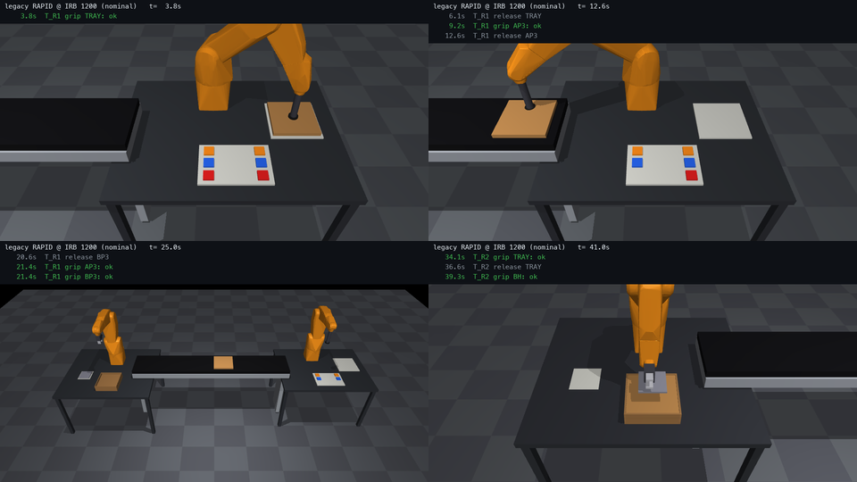

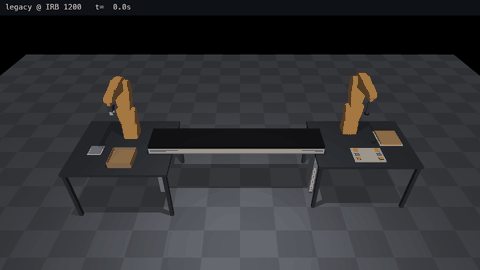

**Human engineer's GoFa port, nominal (held out, scoring only).** It delivers to the oracle.

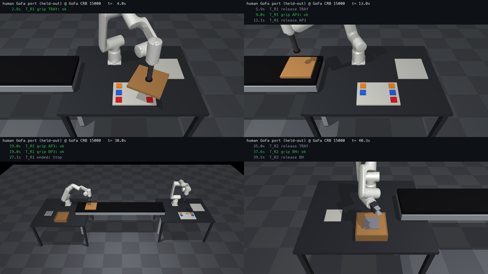

**The failure mode Argon mined from the real footage, injected in simulation.** The legacy grip is open-loop
(`PulseDO DO_ATT_TAB; WaitTime 0.25;`). The tray is never picked up, the program carries on, and it "places" a
tray it doesn't have, then drops parts onto the bare belt.

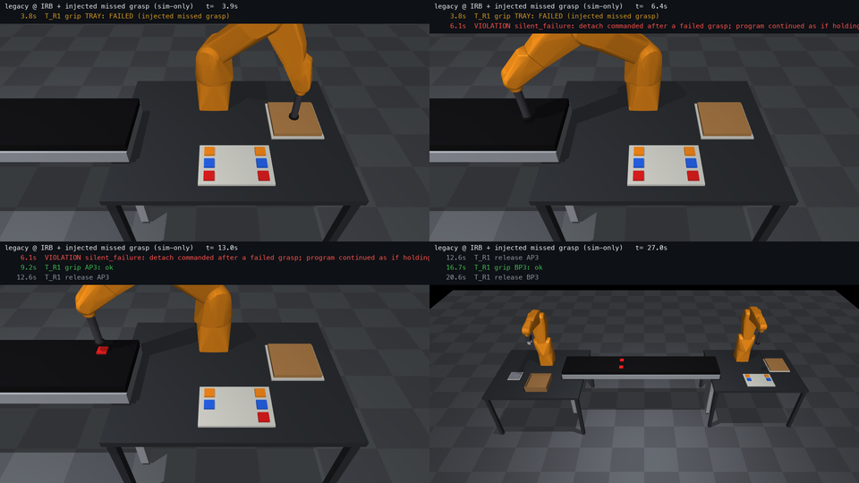

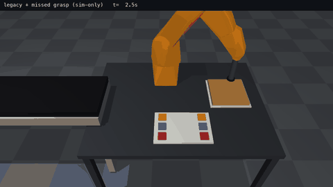

**A guarded program recovers** (hand-written test fixture, never shown to Argon). It proves the suite can be
solved and that the interpreter runs RAPID recovery code: `WaitDI DI_GRIP_OK \MaxTime` → `ERROR` →
re-approach → `RETRY`.

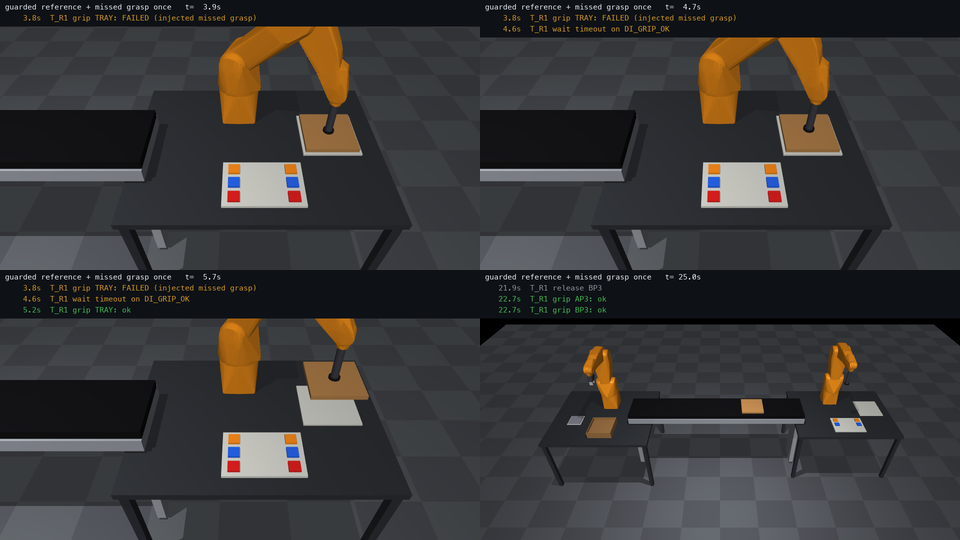

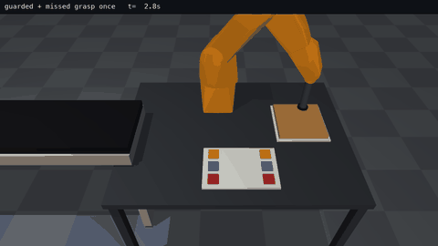

### Scenario suite: the metric the loop will climb

| scenario | legacy @ IRB 1200 | legacy verbatim @ GoFa | human port @ GoFa (held out) | guarded reference (fixture) |
|---|---|---|---|---|
| `nominal` | ✅ delivered | ❌ not delivered | ✅ delivered | ✅ delivered |
| `r1_tray_miss_once` | ❌ not delivered | ❌ not delivered | ❌ not delivered | ✅ delivered |
| `r1_tray_miss_always` | ❌ silent failure | ❌ violations | ❌ silent failure | ✅ safe stop with alarm |
| `r1_part_miss_once` | ❌ not delivered | ❌ not delivered | ❌ not delivered | ✅ delivered |
| `r1_part_miss_always` | ❌ silent failure | ❌ violations | ❌ silent failure | ✅ safe stop with alarm |
| `r1_part_displaced_20mm` | ❌ silent failure | ❌ violations | ❌ silent failure | ✅ safe stop with alarm |
| `r2_tray_miss_once` | ❌ not delivered | ❌ not delivered | ❌ not delivered | ✅ delivered |
| `r2_tray_miss_always` | ❌ silent failure | ❌ violations | ❌ silent failure | ✅ safe stop with alarm |
| `r2_holder_miss_once` | ❌ not delivered | ❌ not delivered | ❌ not delivered | ✅ delivered |
| `r2_holder_miss_always` | ❌ silent failure | ❌ violations | ❌ silent failure | ✅ safe stop with alarm |
| **Cell Pass Rate** | **10%** | **0%** | **10%** | **100%** |

Pass rules: nominal and "once" scenarios must deliver every part to the oracle position (±10 mm) with zero
violations. "Always" scenarios must end in a safe stop with an alarm, and must not carry on as if holding the
part. Fault injection and the `DI_GRIP_OK` sensor are simulation-only.

**Known approximations:** zones run as fine points; confdata acceptance (±1 quadrant on axes 1/4/6) is calibrated
on the two programs known to run; robot-vs-cell collisions aren't checked yet (the geometry is a placeholder);
cycle times are approximate.

## CP4: the Argon port loop (live API run)

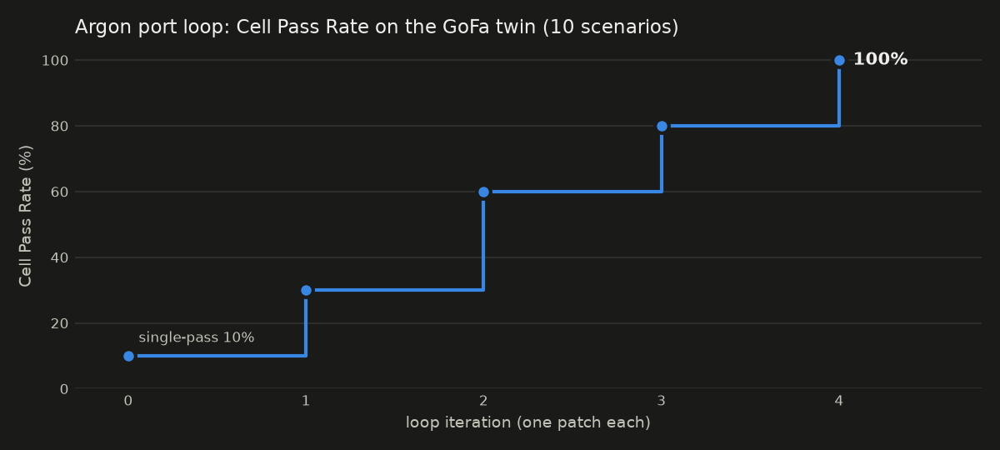

Iteration 0 is Argon's **single-pass port** of both tasks (58 s, `thinking_level=medium`). It's a plain translation
request using the cell facts, with the GoFa robots bolted onto the IRB mounting points, so nothing comes from the
answer key. After that, each iteration runs the 10-scenario suite and renders the first failing scenario (8 s clip,
5 fps). Argon gets the clip, the suite table, the twin trace and the current program, and returns **one routine**.
A patch is kept only if the Cell Pass Rate rises (or stays level while violations fall). All 4 patches were kept;
Argon calls took 11–28 s each.

| iter | failing scenario shown | frame Argon cited | Argon's observation | patch | decision |
|---|---|---|---|---|---|
| 1 | `r1_tray_miss_once` | 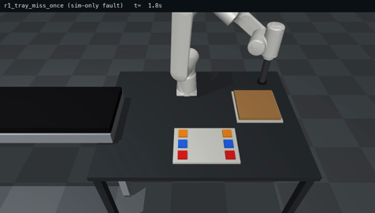 | t=0.0s: R1 approaches the brown tray on the robotic table from above. | `R1.PP_TAB_CONV` | KEPT: CPR 10%->30%, violations 10->8 |
| 2 | `r1_part_miss_once` | 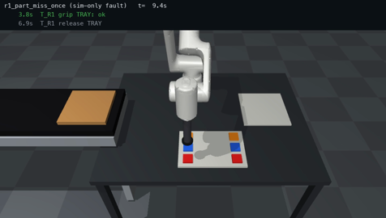 | t=1.4s: R1 descends to the parts holder to pick red part AP3. | `R1.PP_TP_AB` | KEPT: CPR 30%->60%, violations 8->4 |
| 3 | `r2_tray_miss_once` | 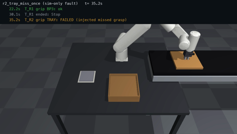 | t=2.0s: R2 reaches Target_TAB_CONV on the conveyor and pulses DO_SG_P and DO_ATT_TTAB, but the tray grasp fails (t=35.2s: T_R2 grip TRAY: FAILED). | `R2.PP_TAB_CONV` | KEPT: CPR 60%->80%, violations 4->2 |
| 4 | `r2_holder_miss_once` | 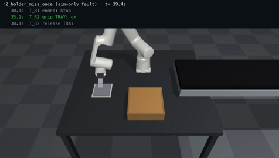 | t=0.6s: R2 moves to the box holder (BH) pick position at Target_INIT_H. | `R2.PP_TAB_H` | KEPT: CPR 80%->100%, violations 2->0 |

Patch from iteration 1, exactly as Argon wrote it (grip check, one re-approach, then a safe stop with an alarm):

```
PROC PP_TAB_CONV()
    MoveL Offs(Target_TAB,0,0,200),r_str.r_param.speed,r_str.r_param.zone,smc_gripper\WObj:=wobj0;
    MoveL Offs(Target_TAB,0,0,0),v100,fine,smc_gripper\WObj:=wobj0;
    PulseDO DO_ATT_TAB;
    WaitTime 0.25;
    IF DI_GRIP_OK = 0 THEN
        MoveL Offs(Target_TAB,0,0,200),r_str.r_param.speed,r_str.r_param.zone,smc_gripper\WObj:=wobj0;
        MoveL Offs(Target_TAB,0,0,0),v100,fine,smc_gripper\WObj:=wobj0;
        PulseDO DO_ATT_TAB;
        WaitTime 0.25;
    ENDIF
    IF DI_GRIP_OK = 0 THEN
        MoveL Offs(Target_TAB,0,0,200),r_str.r_param.speed,r_str.r_param.zone,smc_gripper\WObj:=wobj0;
        ErrWrite "R1 tray grip failed","DI_GRIP_OK=0 after retry";
        Stop;
        EXIT;
    ENDIF
    MoveL Offs(Target_TAB,0,0,200),r_str.r_param.speed,r_str.r_param.zone,smc_gripper\WObj:=wobj0;
    MoveJ Offs(Target_TAB_CONV,0,0,100),r_str.r_param.speed,r_str.r_param.zone,smc_gripper\WObj:=wobj0;
    MoveL Offs(Target_TAB_CONV,0,0,0),v100,fine,smc_gripper\WObj:=wobj0;
    PulseDO DO_DET_TAB;
    WaitTime 0.25;
    MoveL Offs(Target_TAB_CONV,0,0,100),r_str.r_param.speed,r_str.r_param.zone,smc_gripper\WObj:=wobj0;
ENDPROC
```

### Held-out scoreboard (every cell computed by `loop/score.py` from real runs)

| | verbatim copy | Argon single-pass | Argon looped | human port (held out) |
|---|---|---|---|---|
| Cell Pass Rate | **0%** | **10%** | **100%** | **10%** |
| Nominal cycle delivered | ❌ | ✅ | ✅ | ✅ |
| Fault scenarios passed | 0/9 | 0/9 | 9/9 | 0/9 |
| Violations (whole suite) | 10 | 10 | 0 | 10 |
| Target error vs human port (world frame, mean/max mm) | 3546.1 / 5198.5 | 0.4 / 1.3 | 0.4 / 1.3 | — |

The human port is used only here, for scoring. Our GoFas sit on the IRB mounts while the human placed theirs about
100 mm away, so target error is compared in world coordinates.

**Twin fix made during CP4:** the single-pass port used `ConfJ \Off` / `ConfL \Off`, and the interpreter had been
ignoring those instructions. It now honors them (confdata is ignored and the nearest solution wins), as a real
controller would.

**Caveat CP5 will address:** some of Argon's citations quote the burned-in event text, so the next check is a
video-only critic (no overlay, no trace) to prove the diagnosis comes from the pixels.

## CP5: is the critique really visual? (8 clips, pixels only)

Argon got **only** an 8 s clip (no overlay text, no trace, no program) and one paragraph describing the cell. The
clips are the 4 missed-grasp moments plus the same 4 grips succeeding, with randomized clip offsets.
Script: `tests/cp5_video_only_critic.py`.

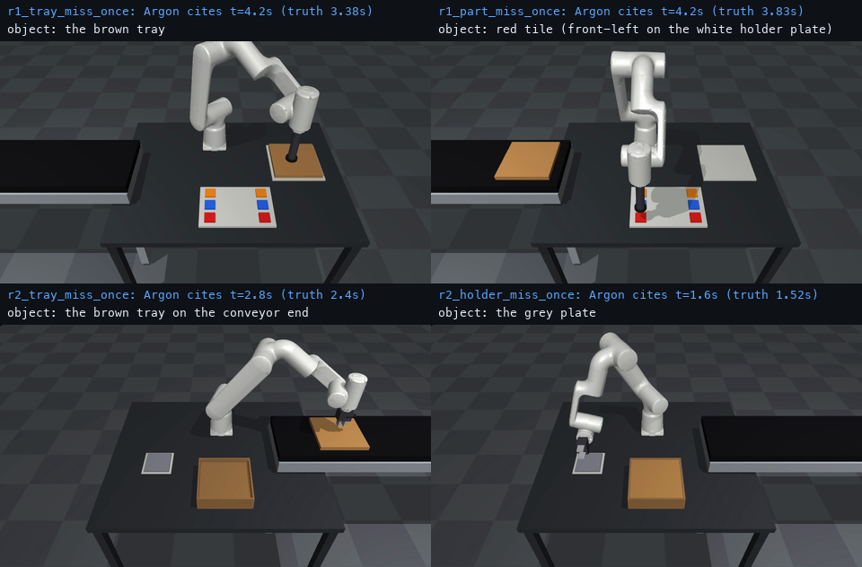

| clip | truth | Argon | correct | failure time true / Argon (s) | what Argon says happens next |
|---|---|---|---|---|---|
| `r1_tray_miss_once` | missed grasp | missed grasp | ✅ | 3.38 / 4.2 | The robot proceeds to move to the black conveyor as if it were holding the brown tray. |
| `r1_tray_miss_once__control` | grasp ok | grasp ok | ✅ | — | Robot 1 successfully picks up the brown tray from the grey plate and places it onto the bl |
| `r1_part_miss_once` | missed grasp | missed grasp | ✅ | 3.83 / 4.2 | The robot lifts away empty and continues its trajectory to the brown tray on the conveyor, |
| `r1_part_miss_once__control` | grasp ok | grasp ok | ✅ | — |  |
| `r2_tray_miss_once` | missed grasp | missed grasp | ✅ | 2.4 / 2.8 | Robot 2 continues its programmed motion to the cardboard box and then to the grey plate wi |
| `r2_tray_miss_once__control` | grasp ok | grasp ok | ✅ | — | Robot 2 successfully grips the brown tray from the conveyor, places it into the cardboard  |
| `r2_holder_miss_once` | missed grasp | missed grasp | ✅ | 1.52 / 1.6 | Robot 2 continues its motion to the cardboard box as if holding the grey plate and perform |
| `r2_holder_miss_once__control` | grasp ok | grasp ok | ✅ | — | Not applicable - all picks in this clip succeed. |

**8/8 correct**: no missed failures and no false alarms, at `thinking_level=low`. Argon's timestamps are the moment
the robot visibly lifts away empty, 0.1–0.8 s after the grip command. In all four failures it also reports the
defect the suite punishes: the robot carries on as if it were holding the part.
